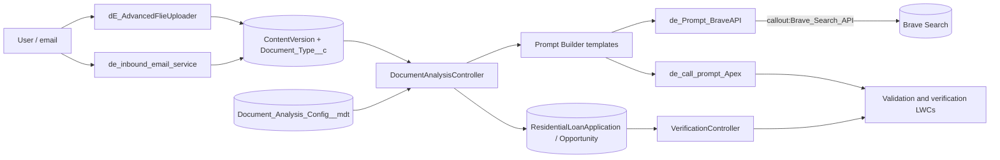

# Doc Verify

**A KYC and income-document validation workbench on Salesforce: upload documents to a loan application, validate them with AI prompts, and review the results in one place.**

## What it does

- **Document upload** (`dE_AdvancedFlieUploader`): uploads files to a record and tags each `ContentVersion` with a `Document_Type__c`. Server side is `DE_AdvancedFileUploaderCtrl`.
- **Inbound email intake** (`de_inbound_email_service`): an Email Services handler that accepts documents sent by email.
- **AI document analysis** (`DocumentAnalysisController`, `documentAnalysis`): for each document type, a Custom Metadata record (`Document_Analysis_Config__mdt`) names the Prompt Builder template to run and the field that stores the result. Shipped configs: Proof of Income, Bank Statement, Form 16, and a final AI Summary.
- **Underwriter summary** (`de_call_prompt_Apex`): invokes the `Underwriter_Summary` prompt template through the Einstein LLM Connect API.
- **Web checks** (`de_Prompt_BraveAPI`): an invocable action that searches the web with the Brave Search API (optionally limited to a site) so a prompt template can ground its answer.
- **Verification dashboards**: LWCs that render JSON stored in `Opportunity.Verification_Summary__c` / `Document_Validation_Summary__c` (read through `VerificationController`) for PAN, Aadhaar, passport and driving-licence checks, plus an agency report summary and summary dashboards.

## Architecture



## Components

| Component | Type | Purpose |
|---|---|---|
| `DocumentAnalysisController` | Apex | Lists documents, runs the configured prompt per document, saves AI output |
| `DE_AdvancedFileUploaderCtrl` | Apex | File upload and document-type tagging |
| `VerificationController` | Apex | Reads verification and validation summaries (cacheable) |
| `de_call_prompt_Apex` | Apex | Calls the `Underwriter_Summary` prompt template |
| `de_Prompt_BraveAPI` | Apex (invocable) | Brave web search via Named Credential |
| `de_inbound_email_service` | Apex | Inbound email handler |
| `dE_AdvancedFlieUploader`, `documentAnalysis`, `de_Underwriter_LWC` | LWC | Upload, analysis view, underwriter view |
| `documentValidationWorkBench`, `documentValidationDashboard`, `documentVerificationDashboard`, `verificationDashboard`, `documentSummaryDashboard` | LWC | Workbench and dashboards |
| `documentValidationDisplay*`, `documentValidationSummary`, `documentValidatorSummary`, `verificationSummaryDisplay`, `documentVerificationReport` | LWC | Validation and verification result displays |
| `panCardValidation`, `panCardVerification`, `verificationPanCard`, `aadhaarCardValidation`, `aadharCardVerification`, `verificationAadhaarCard`, `passportValidation`, `drivingLicenseValidation`, `drivingLicenseValidation2` | LWC | Per-document-type result views |
| `ps_agencyreportsummary`, `ps_verificationreportsummary` | LWC | Agency report summaries |
| `Document_Analysis_Config__mdt` | Custom Metadata | Document type to prompt template and output field |
| `Brave_Search_API`, `Brave_Search_EC`, `Brave_Search_Access` | Named/External Credential, Permission Set | Brave Search auth |
| Opportunity, ResidentialLoanApplication, ContentVersion fields | Metadata | Summary and document-type fields |

## Prerequisites

- Salesforce CLI (`sf`), Node 18+ (lint / Jest only)
- An org with Prompt Builder (Einstein generative AI) and the Financial Services / Mortgage data model (`ResidentialLoanApplication`)
- A Brave Search API key (optional, only for web checks)

## Setup and deploy

```bash
sf project deploy start --source-dir force-app --target-org <alias>
```

Deploy will fail on `ResidentialLoanApplication` fields if the org lacks that object.

## Configuration

Nothing secret is committed. After deploy:

| What | Where | Notes |
|---|---|---|
| Brave API key | Setup > Named Credentials > External Credentials > `Brave_Search_EC` > principal `BravePrincipal` | Add custom header `X-Subscription-Token` = your key. `Brave_Search_API` points at `https://api.search.brave.com`. |
| Permission set `Brave_Search_Access` | Assign to users who run the prompts | Grants the principal |
| Prompt templates | Setup > Prompt Builder | Not included in this repo. Create `Underwriter_Summary` plus the templates named in the `Document_Analysis_Config__mdt` records (`Document_Financial_Analysis`, `Document_Income_Analyst`, ...). |
| Email Service running user | Setup > Email Services > `Email Service` | Committed as `REPLACE_ME@example.com`; set a real user and generate the address |
| Uploader file preview path | `dE_AdvancedFlieUploader.js` | Uses a relative path, no org URL |

## Screenshots

Add screenshots to `docs/screenshots/`.

## License

MIT - see [LICENSE](LICENSE).
